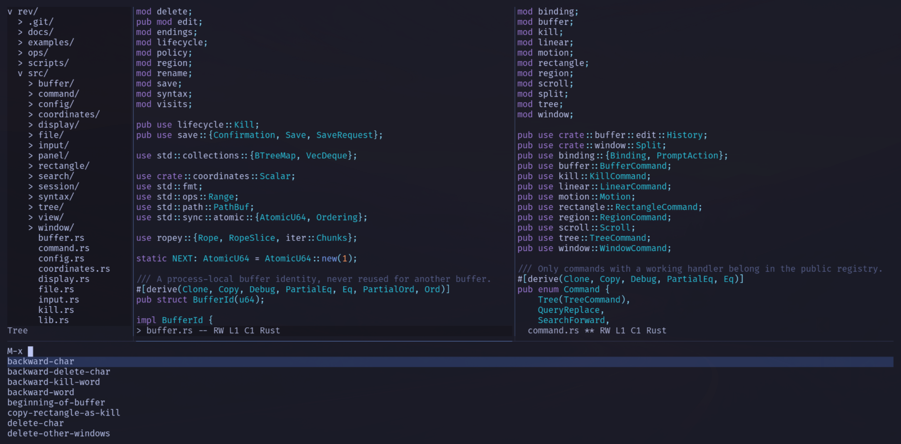

# 

rev is a small terminal text editor written in Rust. It takes its cues from
Emacs's navigation and buffer workflow, with a focus on quick, comfortable
editing.

Multiple buffers, split windows, search and replace, a file tree and
[syntax highlighting](docs/reference/syntax.md) come built in. These are everyday
comforts you can use from the start, without first assembling a set of editor
packages. The goal is a light, responsive editor with a deliberately small scope.



## Install

Requires Linux, Rust 1.98 or newer, Cargo and a C compiler.

From the repository root:

```sh
cargo install --path .
```

## Use

Open a file:

```sh
rev notes.txt
```

Run `rev` without a path for an empty buffer. If the file does not exist, saving
creates it. The editor runs offline.

Startup preferences load from `$XDG_CONFIG_HOME/rev/config.toml`, defaulting to
`~/.config/rev/config.toml`. See [startup configuration](docs/reference/defaults.md#startup-configuration)
for discovery, defaults and the [complete reference sample](docs/reference/config.toml).

## First commands

Type to insert text. `C-` means Control and `M-` means Alt/Meta. Press chords
separated by spaces in sequence: `C-x C-s` means Control-x, then Control-s.

| Keys | Action |
| --- | --- |
| `C-x C-f` | Open a file. |
| `C-x C-s` | Save the current buffer. |
| `C-x b` | Switch buffers. |
| `C-x t t` | Show or hide the file tree. |
| `C-s`, `C-r` | Search forward or backward. |
| `M-x` | Run a command by name. |
| `C-g` | Cancel the current interaction. |
| `C-x C-c` | Quit, with save prompts for modified buffers. |

## Documentation

Start with [editing files](docs/how-to/edit-files.md) or the
[key bindings](docs/reference/bindings.md). The
[documentation index](docs/index.md) links to the full reference, including
terminal input, file handling and recovery. See the [changelog](CHANGELOG.md)
for changes.

## License

Copyright (C) 2026 Adrian PK.

Licensed under the GNU General Public License, version 3 only
(`GPL-3.0-only`). See [LICENSE](LICENSE).
