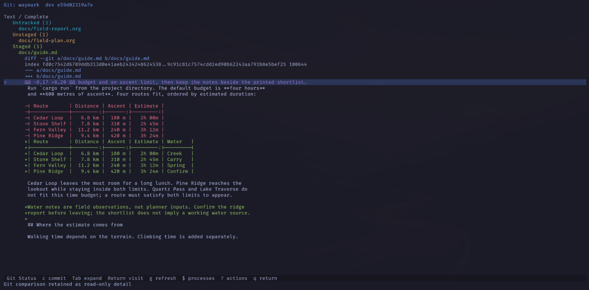
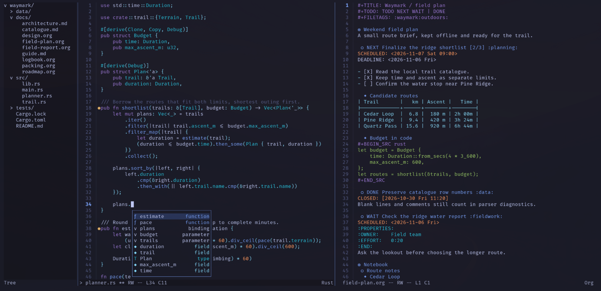
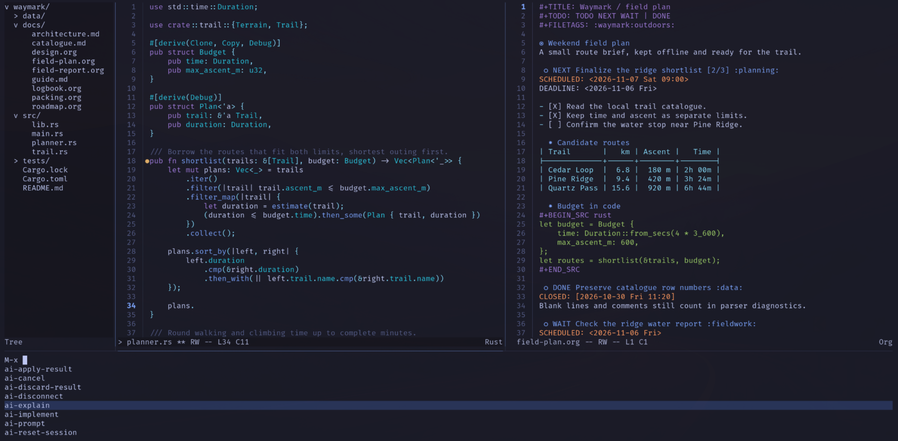
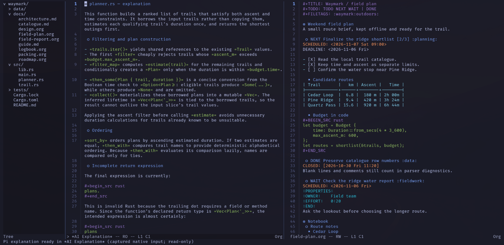
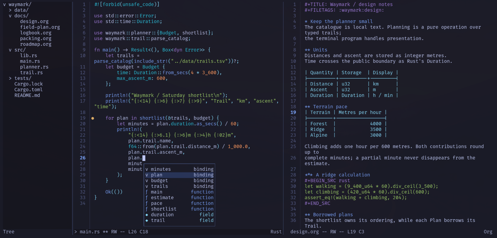
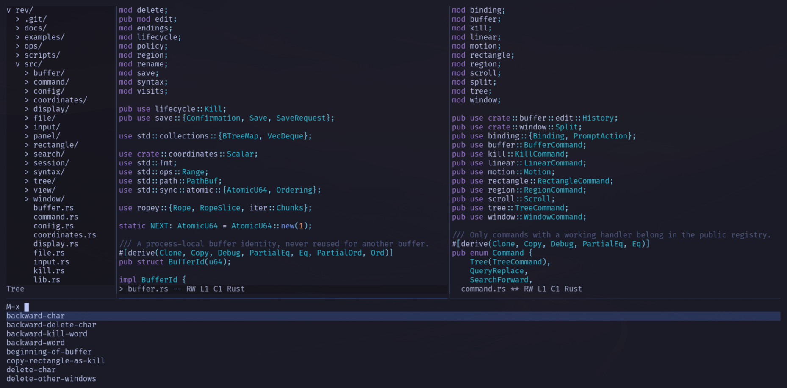

# Gallery

Screenshots of rev in use, newest first.

## Git Status

Git Status shows untracked, unstaged and staged files, with an expanded diff
of a Markdown table.

## Rust and Org

Rust and Org in separate panes, with native completion, named bookmarks and
the file tree. Org headings use the built-in Unicode markers.

## M-x commands

Vertical command completion through `M-x`, with `ai-explain` selected.

## AI explanation

An explanation from Pi in a read-only Org buffer, beside the field notes.
The answer describes the planner and identifies its incomplete return expression.

## v0.2.0

Native completion lists bindings, functions and fields observed in the Rust
buffer. The gutter marker on line 19 shows a named bookmark.

## Earlier

Rust and Org panes beside the file tree, with `M-x` completing a command name.
